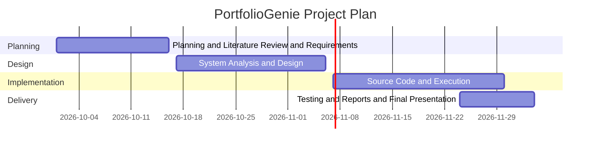

# Project Plan

## Milestones

| Phase | Deadline |
|---|---|
| Planning, Literature Review, Requirements | 16 Oct 2026 |
| System Analysis & Design | 6 Nov 2026 |
| Implementation | 30 Nov 2026 |
| Testing, Reports & Final Presentation | 4 Dec 2026 |

## Deliverables

- Project proposal, plan, roles, risks, and KPIs
- Literature review and requirements
- System design (diagrams and wireframes)
- Source code on GitHub and README
- API and technical documentation
- Test plan and user manual
- Final presentation and infographic

## Gantt Chart

